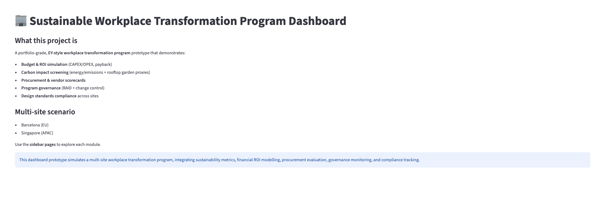
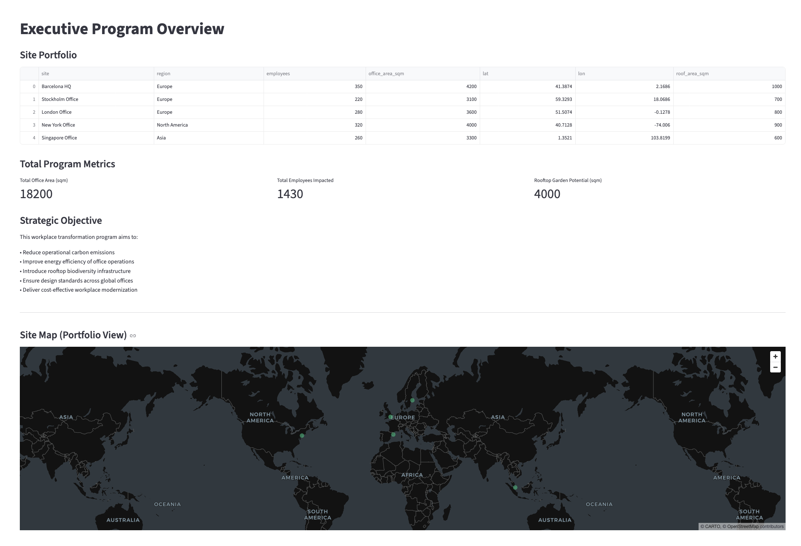
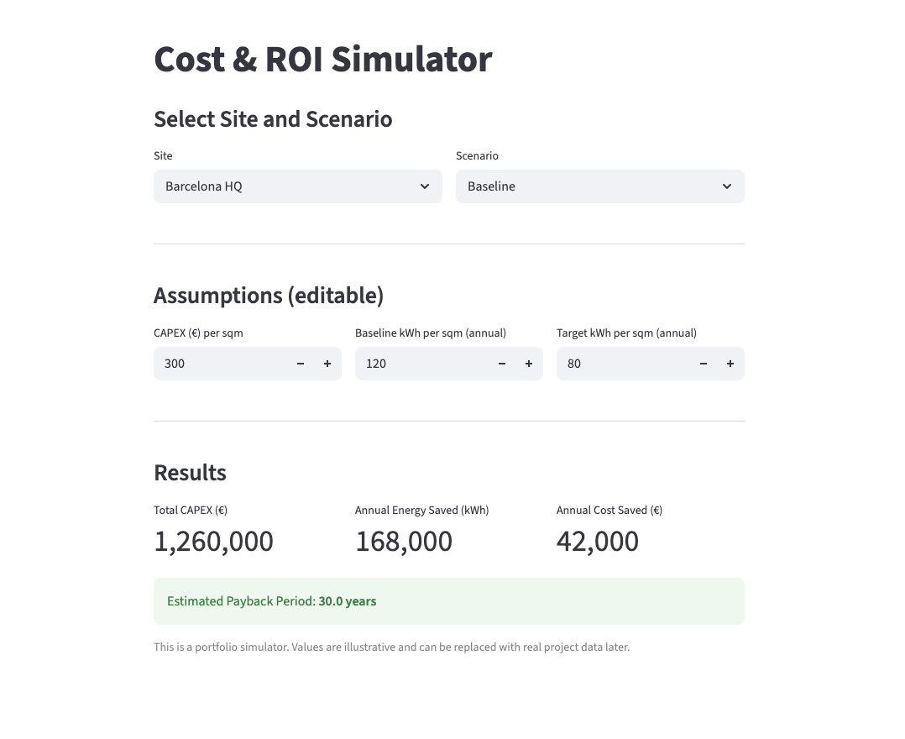
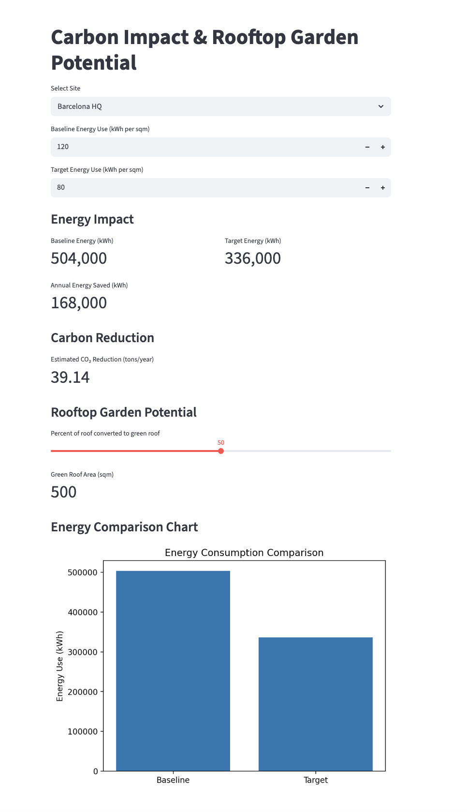
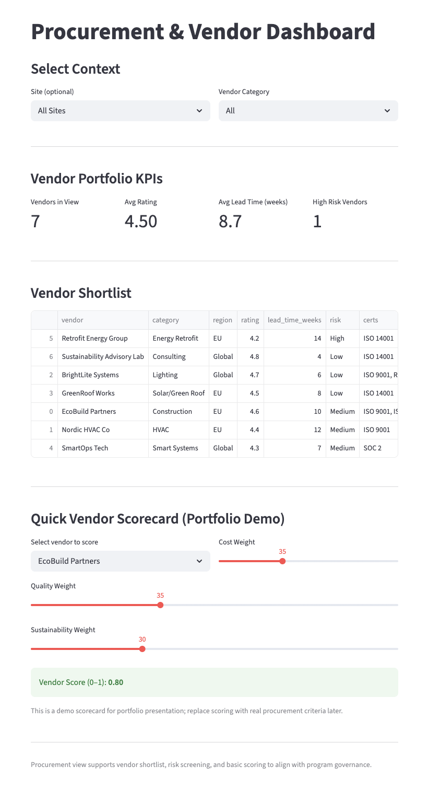
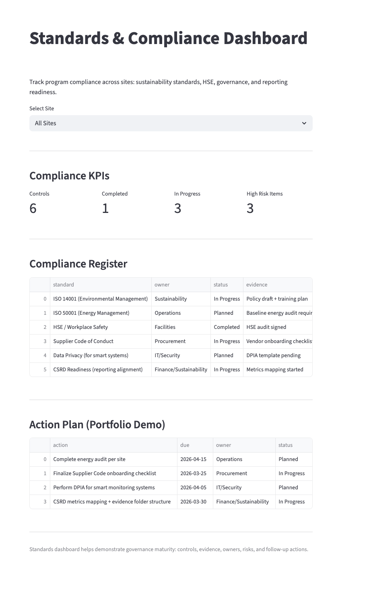

# Sustainable Workplace Transformation Program Dashboard

## Overview
A portfolio-grade Streamlit dashboard simulating a multi-site workplace transformation program. The tool brings together sustainability metrics, ROI modelling, procurement evaluation, governance tracking, and compliance monitoring into one decision-support interface.

## Features
- Executive portfolio overview
- Multi-site office map
- Cost and ROI simulation
- Carbon and green roof analysis
- Governance and risk tracking
- Procurement vendor evaluation
- Standards and compliance monitoring

## How it fits together

Pages render; they do not calculate. Every number comes from a CSV in `data/`
by way of a module in `utils/`, so the dashboard can be repointed at real
project data by editing CSVs alone.

```
data/*.csv          the inputs — sites, scenarios, unit costs, vendors,
                    RAID log, change log, standards and per-site status
utils/io.py         loaders, with the columns each one guarantees
utils/calc_costs.py CAPEX from the measure catalogue, savings, payback
utils/calc_emissions.py  region-specific grid factors, green-roof proxies
utils/scoring.py    vendor scoring, compliance rates, RAG and risk banding
pages/*.py          layout and widgets only
```

`utils/` imports no Streamlit, which is what makes it testable without a
browser.

### What each data file drives

| File | Drives |
|---|---|
| `sites.csv` | Portfolio metrics, the map, every per-site selector |
| `scenarios.csv` | Which measures a scenario switches on, and its energy target |
| `cost_catalog.csv` | Unit cost per measure; `flag_column` joins to `scenarios.csv`, `basis` names the site area it multiplies |
| `vendors.csv` | Procurement shortlist, KPIs and scorecard |
| `raid_log.csv` | Risks, Assumptions, Issues, Dependencies, with severity |
| `change_log.csv` | Change control, net CAPEX and schedule impact |
| `standards_checklist.csv` | The controls being tracked |
| `site_standards_status.csv` | Status of each control at each site |

## Pages
1. **Executive Summary** — portfolio totals, regional breakdown, site map
2. **Cost & ROI Simulator** — scenario-driven CAPEX with a measure-level breakdown, savings and payback
3. **Carbon & Green Roof** — energy and CO₂e using the site's regional grid factor
4. **Governance & PM** — RAID log with impact × likelihood severity, plus change control
5. **Procurement & Vendors** — shortlist, KPIs and a weighted scorecard with its components shown
6. **Standards & Compliance** — per-site register, completion rate and RAG status

## Tests

```
pip install -r requirements-dev.txt
python -m pytest tests/ -q
```

`tests/test_data_layer.py` covers `utils/` directly — payback edge cases, the
green-roof clamp, weight normalisation, RAG and risk boundaries, and referential
checks that every `cost_catalog.csv` row names a real scenario flag and a real
site column. `tests/test_pages.py` renders every page headlessly through
Streamlit's `AppTest` and asserts the scenario and site selectors actually
change what is displayed.

## Live Demo
https://sustainable-workplace-dashboard.streamlit.app/

## Repository
https://github.com/upasanasen/sustainable-workplace-dashboard

## Run Locally

```
pip install -r requirements.txt
streamlit run app.py
```

Figures are illustrative: unit costs, emission factors, vendor ratings and
compliance status are plausible placeholders, not a real programme. The grid
factors are location-based regional averages, adequate for comparing options
and not a Scope 2 inventory.

## Screenshots
### Executive Overview


### Site Portfolio Map


### Cost ROI Simulator


### Carbon Green Roof Analysis


### Procurement Vendor Evaluation


### Compliance Dashboard

